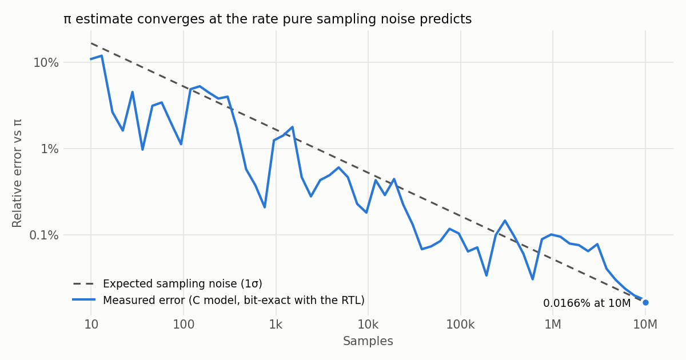
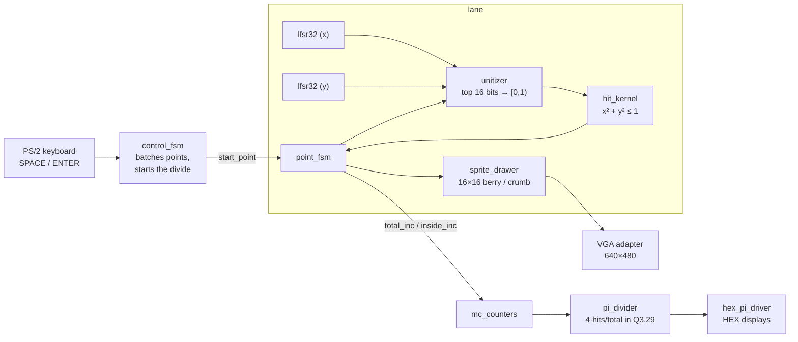

# Monte Carlo π Accelerator (DE1-SoC)

[](https://github.com/juliengaius/monte-carlo-pi/actions/workflows/tests.yml)

A Verilog Monte Carlo engine on an Intel Cyclone V (DE1-SoC) that estimates π by throwing pseudo-random points at a quarter circle and drawing every one of them on a VGA screen in real time. Built with Emily Wang as our ECE241 (Digital Systems) final project at the University of Toronto, Fall 2025.

After the course I went back and added what the project was missing: a bit-exact C reference model, self-checking unit tests, and an automated RTL-vs-model comparison, so the design's behaviour is actually proven rather than eyeballed on a monitor.

<picture>
  <source media="(prefers-color-scheme: dark)" srcset="docs/convergence_dark.png">
  
</picture>

| Result | Value | Evidence |
|---|---|---|
| π after 10M samples | 3.141071 (0.0166% error; sampling noise alone predicts 0.0165%) | [`model/`](model/mc_model.c), [`docs/convergence_10M.csv`](docs/convergence_10M.csv) |
| C model vs RTL | bit-exact on every sample: 100,000 continuous, plus 2,000 across 200 randomly timed key presses | [`sim/compare.py`](sim/compare.py) |
| Throughput | 262 clock cycles per sample, 256 of them drawing the sprite (~191k samples/s at 50 MHz) | [`tb/tb_system.v`](tb/tb_system.v) |
| LFSR | maximal length, period 2³² − 1, checked exhaustively | `mc_model period` |

## How it works



Pressing **SPACE** spawns a batch of 10 points. For each one, `point_fsm` latches the two free-running LFSRs, converts them to coordinates in [0, 1), checks whether the point lands inside the quarter circle, bumps the counters, and draws a berry (hit) or a crumb (miss) at that spot. Pressing **ENTER** runs the divider and shows π on the HEX displays.

The design is deliberately modular: the random number generators, control and counters don't know what problem they're solving. Only `hit_kernel` does. Swapping it for a different kernel (for example `y ≤ f(x)` to integrate a function) reuses everything else unchanged.

### Design decisions

- **Fixed point instead of floating point.** π lies in (0, 4), so the divider uses Q3.29: 3 integer bits and 29 fractional bits, about 9 decimal places. Sampling noise swamps that precision long before it matters, and integer datapaths avoid exponent alignment and normalisation logic entirely, which leaves room for more parallel lanes.
- **32-bit Fibonacci LFSRs** with taps [32, 22, 2, 1] (x³² + x²² + x² + x + 1). Deterministic, so every run is reproducible when debugging, and cheap: just flip-flops and a few XORs.
- **One-cycle start/done handshakes** between the control FSM, point FSM, sprite drawer and divider, so modules with very different latencies (1 cycle to 256) never lose or double-count a point.

## Verification

```bash
# Ubuntu / WSL: sudo apt install iverilog gcc     macOS: brew install icarus-verilog
./sim/run_tests.sh            # unit tests + RTL vs C model (~10 s)
LONG=1 ./sim/run_tests.sh     # adds a 100,000-sample continuous comparison (~3 min)
```

This runs on every push through GitHub Actions.

| Check | What it proves |
|---|---|
| `tb_lfsr32` | reset seed, 1,000 steps against the polynomial, hold when disabled, never locks up at zero |
| `tb_hit_kernel` | corners, axes, and the exact circle boundary: for a sweep of x, the largest y inside is inside and the next y is outside |
| `tb_pi_divider` | exact Q3.29 results, divide-by-zero guard, one-cycle valid pulse, inputs changing mid-divide |
| `tb_system` + `compare.py` | the real control FSM, lane, counters and divider, driven by simulated key presses, match the C model on every sample's latch cycle, x, y and hit, and on the final π |

### The C reference model

[`model/mc_model.c`](model/mc_model.c) re-implements the datapath in a short, dependency-free C program: LFSR step, top-16-bit unitizer, hit kernel, and the 61-bit divider. The hard part of matching it to the RTL was timing, not arithmetic. The LFSRs advance every clock, so which random numbers a point gets depends on exactly which clock edge the unitizer latches them. Working through the FSMs gives a fixed schedule: the first point is latched 2 cycles after SPACE is seen, then one every 262 cycles (GET_RANDOM, COMPUTE_HIT, UPDATE_CNT, 256 drawing cycles, the drawer's DONE, the point's DONE, and the control FSM's re-kick). With that schedule the model matches the hardware bit for bit, and it runs 10 million samples in about 6 seconds, where RTL simulation would take hours.

To make sure the comparison isn't passing by accident, I broke the model on purpose (a 261-cycle period, and a wrong LFSR tap); both were caught at the first sample.

### What the model turned up

- **The two LFSRs are the same sequence, offset in time.** Both use the same polynomial with different seeds, and because the LFSR is maximal length, every nonzero state lies on one cycle. So the y stream is just the x stream delayed by 46,739,488 clocks. Over 10M samples the x/y correlation is −0.0006, within about two standard errors of zero, and the π error sits right on the sampling-noise curve, so it doesn't hurt this estimate. A different polynomial for y would guarantee the streams are independent, and would matter for kernels more sensitive to correlation.
- **Hard limits.** The divider's 61-bit numerator overflows once hits reach 2³⁰ (about 1.37 billion samples), and the 32-bit counters wrap at 2³². Neither is reachable pressing SPACE, but a free-running version would need wider datapaths.
- **Throughput is set by the display, not the maths.** 256 of the 262 cycles per sample are spent drawing the sprite. Decoupling rendering from sampling (draw every Nth point, or queue points to the drawer) and running parallel lanes would raise the sample rate by orders of magnitude.

## Debugging story

The π readout sometimes showed 0.0000 or .9999 even though the counters were correct. We traced it to when the divider captured `hits` and `total`: it wasn't reliably taking them on the cycle the start pulse arrived, so it sometimes divided zeros. The fix makes the divider capture both inputs on exactly the clock edge that sees `start` in IDLE, and `tb_pi_divider` now checks that inputs changing right after the start pulse don't affect the result.

## Who built what

| | Julien Seepersadsingh | Emily Wang |
|---|---|---|
| Course project | module architecture, FSM design and start/done handshakes, `control_fsm` implementation, `lfsr32`, `pi_divider`, `hex_pi_driver`, PS/2 keyboard interface; fixed-point research and scaling | `point_fsm`, `unitizer`, `hit_kernel`, `mc_counters`, `sprite_drawer`, all screen art |
| After the course | C reference model, unit tests, RTL-vs-model comparison, CI, this write-up | |

The VGA adapter, controller, address translator, PLL and the `object_mem` ROM wrapper in [`third_party/`](third_party) came with the course's VGA starter code (built on Intel Quartus IP).

## Repository layout

```
rtl/          our Verilog
third_party/  course-provided VGA adapter and Intel IP wrappers
quartus/      Quartus project for the DE1-SoC (open montecarlo_top.qpf) + sprite/background MIFs
model/        C reference model
tb/           self-checking testbenches
sim/          test runner, RTL-vs-model comparison, simulation ROM stand-in, plot script
docs/         convergence data and plots
```

## Tools

Verilog · Intel Quartus 18.1 · ModelSim · Icarus Verilog · C · Python · DE1-SoC (Cyclone V 5CSEMA5F31C6)
